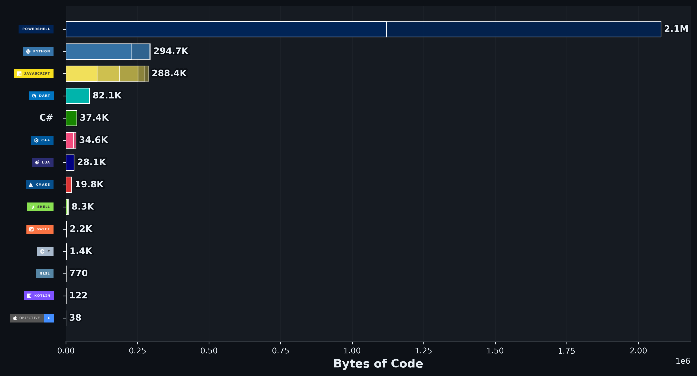

## Weekly-Coding-Stats:

 <!--START_SECTION:waka-->

```txt
JavaScript   3 hrs 4 mins          ███████████▒░░░░░░░░░░░░░   45.77 %
Python       1 hr 6 mins           ████░░░░░░░░░░░░░░░░░░░░░   16.42 %
Bash         31 mins               ██░░░░░░░░░░░░░░░░░░░░░░░   07.95 %
JSON         26 mins               █▓░░░░░░░░░░░░░░░░░░░░░░░   06.64 %
CSS          24 mins               █▓░░░░░░░░░░░░░░░░░░░░░░░   06.01 %
```

<!--END_SECTION:waka-->
---

## Language Stats:




----

