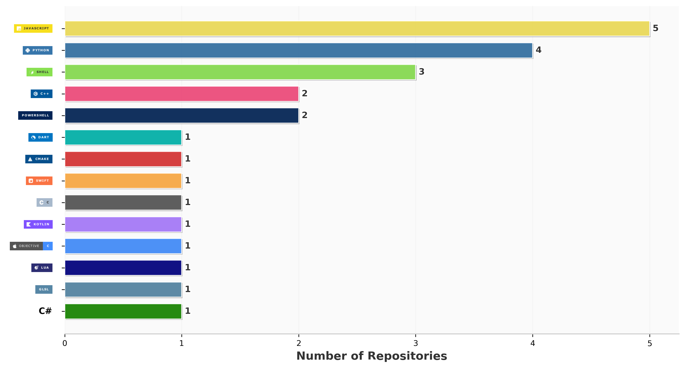

## Weekly-Coding-Stats:

 <!--START_SECTION:waka-->

```txt
JavaScript   31 mins               ██████████████████████▒░░   89.88 %
Markdown     1 min                 █▒░░░░░░░░░░░░░░░░░░░░░░░   05.29 %
Python       1 min                 █▒░░░░░░░░░░░░░░░░░░░░░░░   04.83 %
```

<!--END_SECTION:waka-->
---

## Language Stats




